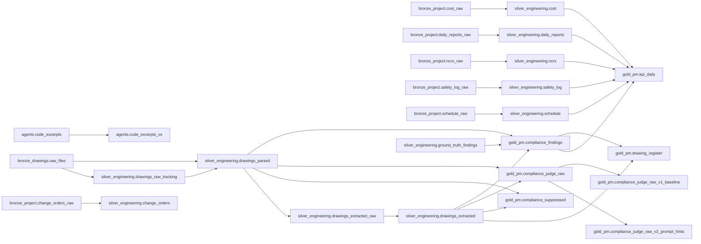

# Lineage edges, `mfg_mc_se_sa.bluerridge_*`

Source: `system.access.table_lineage` and `column_lineage`, read by `06_governance/apply.ipynb` (job run `543672861542223`). 29 distinct table-to-table edges between tables that exist now; dropped scratch tables (for example `_dryrun`) and SDP hidden objects are excluded. System lineage lags the data by minutes to hours, so `drawing_register` (created in this run) appears below.

## Diagram

## Table-level edges

| source | target |
|---|---|
| `agents.code_excerpts` | `agents.code_excerpts_vs` |
| `bronze_drawings.raw_files` | `silver_engineering.drawings_parsed` |
| `bronze_drawings.raw_files` | `silver_engineering.drawings_raw_tracking` |
| `bronze_project.change_orders_raw` | `silver_engineering.change_orders` |
| `bronze_project.cost_raw` | `silver_engineering.cost` |
| `bronze_project.daily_reports_raw` | `silver_engineering.daily_reports` |
| `bronze_project.ncrs_raw` | `silver_engineering.ncrs` |
| `bronze_project.safety_log_raw` | `silver_engineering.safety_log` |
| `bronze_project.schedule_raw` | `silver_engineering.schedule` |
| `gold_pm.compliance_findings` | `gold_pm.drawing_register` |
| `gold_pm.compliance_findings` | `gold_pm.kpi_daily` |
| `gold_pm.compliance_judge_raw` | `gold_pm.compliance_judge_raw_v1_baseline` |
| `gold_pm.compliance_judge_raw` | `gold_pm.compliance_judge_raw_v2_prompt_hints` |
| `silver_engineering.cost` | `gold_pm.kpi_daily` |
| `silver_engineering.daily_reports` | `gold_pm.kpi_daily` |
| `silver_engineering.drawings_extracted` | `gold_pm.compliance_findings` |
| `silver_engineering.drawings_extracted` | `gold_pm.compliance_judge_raw` |
| `silver_engineering.drawings_extracted` | `gold_pm.compliance_suppressed` |
| `silver_engineering.drawings_extracted` | `gold_pm.drawing_register` |
| `silver_engineering.drawings_extracted_raw` | `silver_engineering.drawings_extracted` |
| `silver_engineering.drawings_parsed` | `gold_pm.compliance_findings` |
| `silver_engineering.drawings_parsed` | `gold_pm.compliance_judge_raw` |
| `silver_engineering.drawings_parsed` | `gold_pm.compliance_suppressed` |
| `silver_engineering.drawings_parsed` | `silver_engineering.drawings_extracted_raw` |
| `silver_engineering.drawings_raw_tracking` | `silver_engineering.drawings_parsed` |
| `silver_engineering.ground_truth_findings` | `gold_pm.compliance_findings` |
| `silver_engineering.ncrs` | `gold_pm.kpi_daily` |
| `silver_engineering.safety_log` | `gold_pm.kpi_daily` |
| `silver_engineering.schedule` | `gold_pm.kpi_daily` |

## Paths into `kpi_daily`

| direct sources |
|---|
| `gold_pm.compliance_findings` |
| `silver_engineering.cost` |
| `silver_engineering.daily_reports` |
| `silver_engineering.ncrs` |
| `silver_engineering.safety_log` |
| `silver_engineering.schedule` |

## Paths into `compliance_findings`

| direct sources |
|---|
| `silver_engineering.drawings_extracted` |
| `silver_engineering.drawings_parsed` |
| `silver_engineering.ground_truth_findings` |

## Column-level lineage into `kpi_daily` and `compliance_findings`

25 distinct (source column -> target column) edges.

| target column | source column |
|---|---|
| `gold_pm.compliance_findings.bbox` | `silver_engineering.ground_truth_findings.bbox` |
| `gold_pm.compliance_findings.bbox_source` | `silver_engineering.ground_truth_findings.bbox` |
| `gold_pm.compliance_findings.discipline` | `silver_engineering.drawings_extracted.discipline` |
| `gold_pm.compliance_findings.drawing_type` | `silver_engineering.drawings_extracted.drawing_type` |
| `gold_pm.compliance_findings.matched_ground_truth` | `silver_engineering.ground_truth_findings.bbox` |
| `gold_pm.compliance_findings.page_num` | `silver_engineering.ground_truth_findings.bbox` |
| `gold_pm.compliance_findings.page_num` | `silver_engineering.ground_truth_findings.page_num` |
| `gold_pm.compliance_findings.revision` | `silver_engineering.drawings_extracted.revision` |
| `gold_pm.compliance_findings.volume_path` | `silver_engineering.drawings_parsed.volume_path` |
| `gold_pm.kpi_daily.budget_eac_pct` | `silver_engineering.cost.budget_usd` |
| `gold_pm.kpi_daily.budget_eac_pct` | `silver_engineering.cost.eac_usd` |
| `gold_pm.kpi_daily.budget_overrun_usd` | `silver_engineering.cost.budget_usd` |
| `gold_pm.kpi_daily.budget_overrun_usd` | `silver_engineering.cost.eac_usd` |
| `gold_pm.kpi_daily.budget_total_usd` | `silver_engineering.cost.budget_usd` |
| `gold_pm.kpi_daily.compliance_failed_week` | `gold_pm.compliance_findings.status` |
| `gold_pm.kpi_daily.compliance_passed_week` | `gold_pm.compliance_findings.status` |
| `gold_pm.kpi_daily.compliance_review_week` | `gold_pm.compliance_findings.status` |
| `gold_pm.kpi_daily.milestones_hit` | `silver_engineering.schedule.actual_end` |
| `gold_pm.kpi_daily.open_ncrs_compliance` | `silver_engineering.ncrs.category` |
| `gold_pm.kpi_daily.open_ncrs_workmanship` | `silver_engineering.ncrs.category` |
| `gold_pm.kpi_daily.safety_days_without_incident` | `silver_engineering.safety_log.event_date` |
| `gold_pm.kpi_daily.schedule_status` | `silver_engineering.schedule.planned_end` |
| `gold_pm.kpi_daily.slipped_days` | `silver_engineering.schedule.planned_end` |
| `gold_pm.kpi_daily.slipped_milestone_id` | `silver_engineering.schedule.milestone_id` |
| `gold_pm.kpi_daily.trir_28d` | `silver_engineering.daily_reports.headcount` |
