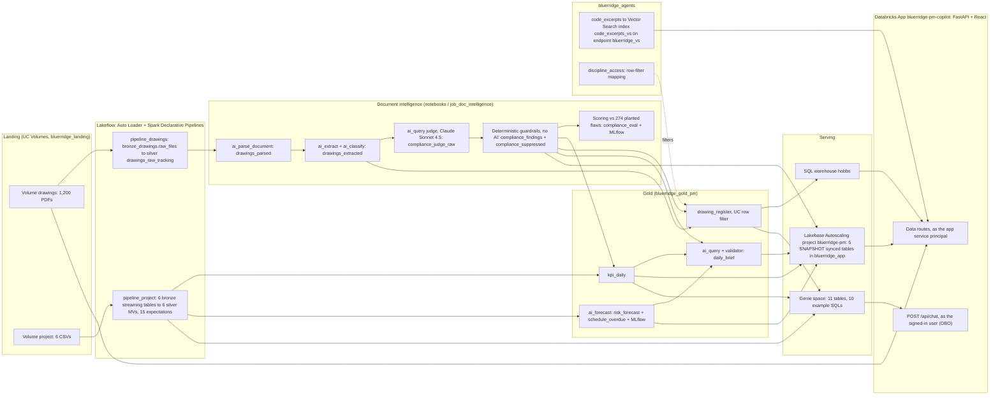

# Architecture (as built)

This page describes the system that is deployed, not the design intent: the spec ([`superpowers/specs/…-design.md`](superpowers/specs/2026-11-06-bluerridge-pm-copilot-design.md)) holds that. Every name below is a real object in catalog `mfg_mc_se_sa` or a real file in this repo. The evidence for each part is mapped in [`evidence/00_READ_ME_FIRST.md`](../evidence/00_READ_ME_FIRST.md).

## Data flow

Read it left to right:

1. **Landing.** PDFs and CSVs land in two UC Volumes.
2. **Lakeflow.** Two serverless, triggered SDP pipelines ingest them with Auto Loader. Bronze keeps what the source sent. Silver types, trims and checks it with expectations, and a non-PDF is flagged in `_rescued_data` rather than crashing the run.
3. **Document intelligence.** It runs over silver:
   - parse each drawing, then extract the title block and classify it;
   - an `ai_query` judge applies five code rules and writes one row per finding;
   - deterministic guardrails remove findings the rule cannot apply to, or that contradict the drawing's own text;
   - a scoring notebook grades the result against the generator's planted flaws.
4. **Gold.** These tables are what the PM sees: daily KPIs, an `ai_forecast` schedule-risk table, the overdue list, a daily brief and the governed `drawing_register`.
5. **Serving.** Lakebase serves the hot-path tables, the warehouse serves the governed table, and the Genie space answers ad-hoc questions.

## The app

React 18 + Vite + Tailwind SPA, served by FastAPI from `09_app/frontend/dist`. Backend in `09_app/backend/`. Endpoints and the chat event stream: [`09_app/API.md`](../09_app/API.md).

| Screen | Calls | Source | Identity |
|---|---|---|---|
| KPI strip, daily brief (the chat's seed message), risk card, late list, sidebar badge | `/api/kpi/today`, `/api/brief/today`, `/api/risk/top`, `/api/schedule/overdue`, `/api/compliance/summary` | Lakebase synced tables | service principal |
| Chat | `POST /api/chat` (Server-Sent Events) | Genie space; drawing sources enriched from Lakebase FAIL findings | **signed-in user** for Genie; SP for the enrichment read |
| Compliance page | `/api/compliance/findings` (server-side pagination) | Lakebase `compliance_findings_synced` | service principal |
| Drawing viewer | `/api/drawings/{id}`, `/api/drawings/{id}/pdf` | warehouse `drawing_register` (row-filtered) + Lakebase findings; PDF from the Volume through the Files API | service principal |
| Citation panel | `/api/citations/{label}` | Vector Search exact `citation_label` filter + 3 related; SQL fallback on `code_excerpts` | service principal |
| Identity chip | `/api/whoami` | forwarded headers only | none (reports `OBO` or `SP`) |

The PDF viewer (`react-pdf` / `pdfjs-dist`) draws the finding's normalized `[x, y, w, h]` box (top-left origin) over the page. The box comes from one of three places (`compliance_findings.bbox_source`):

- `ground_truth`: the planted flaw's own box. This is where the tight demo highlights come from.
- `parse_element`: the parser element that contains the judge's quoted evidence, which is what production would use.
- `page`: the whole page.

Boxes from anything other than `ground_truth`, and boxes that are clamped or larger than 25% of the page, are labelled "approximate location".

## Identity split: OBO for Genie, service principal for data

Two identities, chosen per call ([`09_app/backend/auth.py`](../09_app/backend/auth.py), research in [`AUTH_NOTES.md`](../09_app/backend/AUTH_NOTES.md)):

- **On behalf of the user (OBO), only for Genie.** The Apps proxy forwards the user's short-lived token in `x-forwarded-access-token`. This happens because the app resource declares `user_api_scopes: [dashboards.genie, sql]` (`resources/app.yml`). `user_workspace_client(request)` builds `WorkspaceClient(token=…, auth_type="pat")` per request. `auth_type="pat"` matters because the app's environment also carries the SP's OAuth client id and secret, and without it the SDK could pick those up.
  - The client is a FastAPI dependency of `/api/chat`, so a request without the header gets **401** before the route runs.
  - There is no SP fallback. The SP is never used for Genie (unit tests assert this); the chat's drawing-source enrichment does read Lakebase through the app SP pool. Tests also assert that a planted token never appears in an event or a log line.
  - Because Genie runs as the PM, every Genie SQL runs with that PM's Unity Catalog permissions, including the `drawing_register` row filter.
- **App service principal for everything else.** `sp_workspace_client()` is a cached `WorkspaceClient()` built from the injected SP credentials. It covers Lakebase (a psycopg pool whose connections each get a freshly generated database credential), the warehouse (Statement Execution API with named parameters only), the Volume (Files API) and Vector Search. The SP's access is least-privilege, applied by `scripts/post_deploy_grants.sh`:
  - USE and SELECT on `bluerridge_gold_pm` and `bluerridge_agents`;
  - READ VOLUME on `drawings`;
  - a `'*'` row in `discipline_access`;
  - SELECT, and nothing else, on the five Postgres tables.
- **Verified live.** In a signed-in session, `whoami` logged `auth_mode=OBO` and the chat was answered as the user ([`09_app/outputs/live_obo_chat.md`](../09_app/outputs/live_obo_chat.md)). The startup self-test proves the SP's side ([`chat_selftest.md`](../09_app/outputs/chat_selftest.md)).

## Genie transport: managed MCP server first, Conversation API as a guarded fallback

`backend/genie.py` speaks to the space in two ways, with the same (user) client.

- **Primary: the managed Genie MCP server for the space** (Public Preview), `POST {host}/api/2.0/mcp/genie/{space_id}`. It makes stateless JSON-RPC `tools/call` requests: `query_space_<id>`, then `poll_response_<id>` until the message is terminal. It reads the answer text, SQL, rows and conversation id from `structuredContent`.
  - The POST bypasses the SDK's retrying HTTP client, because a retried `query_space` could post the question twice.
  - Each call gets the remaining part of a 110 s deadline as its read timeout and is never retried.
  - The `Authorization` header comes from `w.config.authenticate()` and lives only inside the request.
- **Fallback: the Genie Conversation API** (`w.genie.start_conversation` / `create_message` / `get_message` / `get_message_attachment_query_result`). It is used only when MCP refuses the **first** call in a way that comes before Genie can have accepted the question:
  - HTTP 400, 403, 404, 405, 406 or 415;
  - JSON-RPC parse, invalid-request, method or params errors;
  - a connection that could not be opened.

  Everything else ends in a safe error event and is not retried: 5xx, 429, read timeouts, a dropped connection after sending, and poll errors. "Never asks twice" rests on the assumption that those refusals happen before acceptance (see `09_app/API.md`).
- **What happened live.**
  - As the **SP**, the self-test question goes through MCP: `transport=mcp status=COMPLETED got_sql=True rows=1 headline=51`.
  - As the **signed-in user**, MCP refused the first call with HTTP 403, and the fallback answered: `transport=conversation_api outcome=done got_sql=True rows=85`. The cause of the 403 was not diagnosed. The likely cause is that the user token's OBO scopes do not cover the MCP endpoint.

  Both the `done` event and the per-chat log line name the transport, and the UI's execution note reads it. In the live session, the note said "via Conversation API".
- **The stream** (`backend/routes/chat.py`) emits these events in order:
  1. `status: running` (repeated as a heartbeat);
  2. `conversation`;
  3. `answer`;
  4. `sql`;
  5. `result` (capped at 50 rows, any `slip_probability` column stripped);
  6. `sources` (drawing ids enriched from Lakebase with page, bbox and citation, plus code-citation links);
  7. `status: done` with the transport, or a fixed safe `error` message.

## The Lakebase hot path

The app's first screen makes five small point reads: the KPI row, the brief, the risk card, the late list and the sidebar badge. They are served from **Lakebase Autoscaling** project `bluerridge-pm` (Postgres 17, one `production` branch, the `primary` endpoint pinned to 1 CU). The source is five gold tables synced into schema `bluerridge_app`:

| Gold source | Postgres table | Primary key | Rows |
|---|---|---|---|
| `kpi_daily` | `bluerridge_app.kpi_daily_synced` | `project_id, snapshot_date` | 90 |
| `compliance_findings` | `bluerridge_app.compliance_findings_synced` | `drawing_id, finding_id` | 1,379 |
| `risk_forecast` | `bluerridge_app.risk_forecast_synced` | `milestone_id` | 64 |
| `schedule_overdue` | `bluerridge_app.schedule_overdue_synced` | `milestone_id` | 7 |
| `daily_brief` | `bluerridge_app.daily_brief_synced` | `project_id, brief_date` | 1 |

- **Why Lakebase.** A KPI point read measured p50 **3.0 ms** over an open Postgres connection, against **428 ms** for the same read through the SQL warehouse's Statement API ([`synced_tables_listing.md`](../08_lakebase/outputs/synced_tables_listing.md)). The warehouse stays the engine for scans, aggregations and the governed table.
- **Why SNAPSHOT.** The gold tables are rebuilt with `CREATE OR REPLACE` and have no Change Data Feed, so a refresh is a re-sync after each gold run.
- **How it is declared.** Both the project and the synced tables are bundle resources (`postgres_projects`, `postgres_synced_tables` in [`resources/lakebase.yml`](../resources/lakebase.yml)). The app binds the database through the `postgres` resource key. It reads the injected `PG*` variables and generates an OAuth database credential per pooled connection. The pool's 30-minute `max_lifetime` is shorter than the credential's lifetime of about one hour.

## Governance placement: why `drawing_register` is not synced

- **The one row filter.** `gold_pm.drawing_register` carries a real Unity Catalog row filter, `bluerridge_agents.rf_drawing_discipline(discipline)`. It calls `discipline_allowed(current_user(), discipline)` against the mapping table `discipline_access`, where `'*'` means all disciplines. The filter is attached with `ALTER TABLE … SET ROW FILTER` ([`06_governance/row_filters.sql`](../06_governance/row_filters.sql)), and its allow and deny results are asserted in [`evidence/grant_listing.md`](../evidence/grant_listing.md).
- **Why that table is not synced.** Row filters and column masks do not propagate to Lakebase synced tables. A Postgres copy would give every connected role every row, which would silently bypass the filter. So `drawing_register` is **deliberately not synced**, and the app reads it through the SQL warehouse, where the filter is enforced. The SP is mapped to `'*'`, so the app's own reads see all 1,200 drawings (`drawing_register_visible=1200` in the self-test). In the chat, Genie queries `drawing_register` as the PM, so the PM's own mapping applies.
- **Where filters are never put.** Never on the Lakebase sources (`kpi_daily`, `compliance_findings`, `risk_forecast`, …) or on pipeline inputs. A filter there would break the sync and the notebooks.
- **The rest of the governance layer.**
  - 112 tags. The keys are prefixed `br_` because the account's governed tags own `layer`, `sensitivity`, `data_class` and `domain`.
  - 29 table-level lineage edges from system tables.
  - Least-privilege grants for the app's SP.
  - Stated plainly: the shared catalog's inherited `account users` access makes every `bluerridge_*` table readable account-wide. The row filter is the only control this build adds, which is acceptable only because all data is synthetic.

## Document intelligence: how a finding is made

1. **Parse.** `ai_parse_document` reads each PDF from the Volume and writes `drawings_parsed`: markdown in reading order with page markers, plus element boxes. 1,200 parsed, 0 errors.
2. **Extract and classify.** `ai_extract` pulls the title block and cited standards, and `ai_classify` picks one of `ISO`, `PID`, `GA`, `SPEC`, `OTHER`. Checked against the generator over all 1,200 drawings: the type was right for 1,200 and the discipline for 1,198 (2 were not recognised and set to NULL).
3. **Judge.** `ai_query('databricks-claude-sonnet-4-5', …)` gets each drawing's parsed text and a fixed five-rule prompt (v3, neutral: no value, tag or example the generator draws from). It returns JSON with one `findings` entry per violation: citation, severity, reason, page, a verbatim evidence quote, the `expected_item` that would make the drawing comply, and the judge's own `found_in_text` self-check for that item. Unusable answers become `REVIEW` rows.
4. **Guardrails** (`03b`, `compliance_lib.judge_with_guardrails`, unit-tested, no AI call). They remove two kinds of entry:
   - **Rule applicability:** a rule fired on a drawing type that cannot show the item, such as a lockout tag on a pipe isometric.
   - **Self-contradiction:** the expected item is present in the text, or the reason admits compliance.

   Every removed entry is kept in `compliance_suppressed`, along with why it was removed and whether it was a planted flaw. That is the audit trail.
5. **Score** (`04`, no AI call). `(drawing_id, citation)` pairs are scored against the 274 planted flaws for columns A (raw), B (self-check) and C (guardrails). The final column C scores precision 58.1%, recall 81.0% and F1 67.7%. MLflow logs one run per prompt version and column. Prompt v2 contained dataset-derived hints and is kept only as superseded lineage.

The daily brief (`05_gold/03_daily_brief.ipynb`) is the second GenAI step. It is `ai_query` over a context JSON built from gold tables only, then `brief_lib.validate_brief`. That is a deterministic validator that checks:

- every number and id against the context;
- the count wording ("6 already late", "26 High");
- the section content;
- that no probability language appears;
- the length.

A failed draft gets one retry with the failures appended, and the result is stored with its `validation_status`.

The schedule-risk forecast (`05_gold/02_risk_forecast.ipynb`) runs `ai_forecast` on the SQL warehouse. It forecasts the weekly mean slip of finished milestones per discipline, 13 weeks ahead with an 80% interval. Each open milestone due in the next 90 days takes its discipline's forecast plus any float-adjusted delay inherited from a late predecessor. A normal-curve score turns that into High, Medium or Low bands. The backtest shows it is about as good as a naive baseline and is overconfident, so the app and the brief show bands only and never a percentage.

## Packaging

One bundle, `databricks.yml` + `resources/`, target `demo`, deploys these resources:

- 2 pipelines;
- 3 jobs (doc intelligence, a PAUSED weekly risk refresh and synthetic data);
- the Vector Search endpoint and index;
- the Genie space (`genie_spaces`);
- the Lakebase project and its 5 synced tables;
- the app, with 4 resource bindings and its OBO scopes.

CLI v1.20 has no deploy hooks. The schema notebook, the notebook runs and the SP grants therefore follow the single order in [`docs/BUILD.md`](BUILD.md#deploy-order). The committed notebook outputs came from one-time serverless runs captured by `scripts/nb_evidence.py`.
